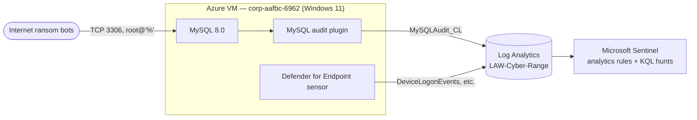

# MySQL Honeypot — Live Ransom Breach: Threat Hunt & Incident Response

**A real, internet-sourced ransomware breach — detected, hunted, scoped, and recovered.**

Full-lifecycle incident investigation from the LOG(N) Pacific Cyber Range
(*SecOps 6: Live Breach & Incident Response*): an intentionally vulnerable Windows + MySQL
VM in Azure, instrumented into Microsoft Sentinel, deliberately exposed to the internet, and
then worked as the **real** breach automated ransom bots carried out — within ~1.5 hours of
exposure. All data in the environment is synthetic.

---

## 📌 Description

A honeypot built to get breached on purpose. Minutes after the MySQL port went public, an
automated actor logged in as `root`, read every table, dropped the `mcgraw_hill_holdings_corp`
database, purged the binary logs, and left a Bitcoin ransom note — then the box was re-ransomed
by multiple bots over ~14 hours. This repo is my detection, hunt, scoping, and recovery of it.

| | |
|---|---|
| **Incident type** | Automated database ransom / data destruction against an internet-exposed MySQL service |
| **Entry** | Weak, network-enabled `root@'%'` on MySQL/3306 open to the internet — no exploit required |
| **Impact** | `mcgraw_hill_holdings_corp` read, then dropped; binary logs purged; service shut down; ransom note left |
| **Host compromise** | **None** — proven via Defender investigation-package diff; the OS was never touched |
| **Dwell time** | First malicious login → database destroyed in **~2 minutes** |
| **Recovery** | Restore from off-host backup (binlogs were purged, so no point-in-time recovery) |

---

## 🏗️ Architecture



Every connection and statement was recorded **off-host** in Sentinel before exposure — which is
why the attacker's own `PURGE BINARY LOGS` couldn't erase the evidence.

---

## 🧰 Tech Stack

| Layer | Tools |
|-------|-------|
| Cloud / host | Microsoft Azure, Windows 11, Azure Bastion, NSG |
| Database | MySQL 8.0 + audit log plugin |
| SIEM / telemetry | Microsoft Sentinel, Log Analytics (`LAW-Cyber-Range`), Microsoft Defender for Endpoint |
| Analysis | KQL (Kusto), Defender Advanced Hunting, MDE investigation packages |
| Data | Synthetic corporate DB generator (built with a local LLM) |

---

## ⏱️ Incident Timeline (first breach)

Times in Eastern (EST), as the Defender portal displays them; raw log timestamps are UTC.

| Time (EST) | Event | Source |
|---|---|---|
| Nov 16, 7:42 PM | VM exposed to the internet (`root@'%'` reachable on 3306) | Phase 5 exposure timestamp |
| Nov 16, 9:18 PM | First `root` login from `64.89.163.93` after one failed attempt | `MySQLAudit_CL` |
| Nov 16, 9:20:28 PM | `GRANT CREATE, DROP ON *.* TO root@%` — self-escalation | `MySQLAudit_CL` |
| Nov 16, 9:20:31–9:21:15 PM | `USE mcgraw_hill_holdings_corp; SELECT *` on all 7 tables | `MySQLAudit_CL` |
| Nov 16, 9:20:23 PM | `CREATE DATABASE RECOVER_YOUR_DATA` + ransom note inserted | `MySQLAudit_CL` |
| Nov 16, 9:21:17–9:21:42 PM | `DROP` of foreign keys, all 7 tables, then the database | `MySQLAudit_CL` |
| Nov 16, 9:22:03–9:22:05 PM | `RESET MASTER`, `PURGE BINARY LOGS`, `REVOKE … root@%`, `SHUTDOWN` | `MySQLAudit_CL` |
| Nov 17, 1:25–11:24 AM | Re-ransom note re-plants from the same `64.89.163.x` block | `MySQLAudit_CL` |
| Nov 17, 6:20–6:31 AM | Windows `administrator` brute force from `194.180.49.140` — **all failed** | `DeviceLogonEvents` |
| Nov 18, 6:24 PM | VM isolated in Microsoft Defender | Phase 8 isolation |

---

## ⛓️ Attack Chain (MITRE ATT&CK)

| # | Technique | ID | What happened |
|---|---|---|---|
| 1 | Brute Force | T1110 | Automated password spray against MySQL `root` over 3306 |
| 2 | Valid Accounts | T1078 | Logged in as `root` with the weak, exposed password |
| 3 | Account Manipulation | T1098 | `GRANT CREATE, DROP ON *.*` self-escalation |
| 4 | Data from Info Repositories / Exfil | T1005 / T1041 | `SELECT *` across all 7 tables (read in-session; off-host egress not confirmed) |
| 5 | Data Destruction | T1485 | Dropped every table, then the `mcgraw_hill_holdings_corp` database |
| 6 | Indicator Removal | T1070 | `RESET MASTER` / `PURGE BINARY LOGS` — killed point-in-time recovery |
| 7 | Service Stop | T1489 | MySQL `SHUTDOWN` |
| 8 | Financial Theft | T1657 | Bitcoin ransom note (`RECOVER_YOUR_DATA`), 0.0131 BTC, 48-hour deadline |

Entry maps conceptually to **T1133 (External Remote Services)** — a database service needlessly
exposed to the internet.

---

## 🔬 Key Finding — No Host Compromise

The breach lived entirely in the MySQL data layer. I diffed the **pre-breach vs post-breach
Defender investigation packages** (same host, confirmed by machine SID): local users and group
membership byte-identical, no new scheduled tasks / services / autoruns, no attacker binaries,
and `Security.evtx` *grew* (ruling out log clearing). The Windows `administrator` brute force
failed on every attempt. Two separate doors — the attacker only ever needed the open one
(MySQL/3306). Full analysis: [`reports/dfir-package-comparison.md`](reports/dfir-package-comparison.md).

---

## ♻️ Containment, Eradication & Recovery

- **Contain** — VM isolated in Microsoft Defender; pre/post investigation packages captured.
- **Eradicate** — removed the exposed inbound rule; bound MySQL to `127.0.0.1`; deleted the
  network `root@'%'` account; re-enabled Windows Firewall; removed the weak Windows admin account.
- **Recover** — dropped the whole ransom schema (`DROP SCHEMA recover_your_data;` — dropping only
  the table leaves the schema behind) and restored `mcgraw_hill_holdings_corp` from an **off-host
  backup**. Because the attacker purged the binary logs, the backup was the only path back — the
  single most important control in the case.

---

## 🗺️ Detection Roadmap & Lessons

1. **Never expose a database service to the internet.** Bind MySQL to `127.0.0.1`; keep 3306 off
   any public NSG rule. This one control prevents the entire incident.
2. **Kill weak, network-wide DB accounts.** No `root@'%'`; least privilege, strong passwords, host
   restrictions. Valid credentials over an exposed service — not an exploit — were the whole attack.
3. **Alert on *actions*, not just logins.** Current rules catch the logon; next is behavioral
   detection for `DROP DATABASE` / `RESET MASTER` / `RECOVER_YOUR_DATA` so destruction pages in
   near-real-time.
4. **Centralize logs.** The attacker purged MySQL binlogs, but every statement had already shipped
   to Sentinel. You can't delete logs that already left the building.
5. **An empty result is a claim to verify, not a conclusion** — case-sensitive `==` and a too-narrow
   time picker caused most of my false "nothing's here" moments.

---

## 📁 Project Structure

```
mysql-honeypot-live-breach/
├── README.md                              # this file
├── reports/
│   ├── incident-report.md                 # full incident report (+ screenshots)
│   ├── dfir-package-comparison.md         # pre/post host diff — no compromise
│   └── media/                             # hunt-output screenshots
├── queries/                               # documented KQL hunts (01–05)
├── database/
│   └── SyntheticDatabase_Generator_v1.0.sql
├── iocs/
│   ├── iocs.md                            # indicators of compromise
│   └── ransom-note.txt                    # recovered ransom note
├── writeup/
│   └── build-it-break-it-catch-it.md      # first-person reflection
├── LICENSE
└── .gitignore
```

---

## ⚙️ Reproduce the Lab

1. Deploy a Windows 11 VM in Azure; install MySQL 8.0 and enable the audit log plugin.
2. Load synthetic data with [`database/SyntheticDatabase_Generator_v1.0.sql`](database/SyntheticDatabase_Generator_v1.0.sql).
3. Wire `MySQLAudit_CL` and Defender for Endpoint telemetry into a Log Analytics workspace.
4. Author Sentinel analytics rules **while the box is clean**.
5. Weaken and expose: firewall off, NSG allow-all, `root@'%'` reachable on 3306 — and record the
   exact exposure timestamp.
6. Wait for the real breach, then detect → analyze → contain → eradicate → recover.

---

## 📐 KQL Hunts & Analytics Rules

All hunts are in [`queries/`](queries) — each with a header comment and a note on every `let`
variable. The reliable pattern throughout: `_ResourceId` is stored lowercase, so match the VM with
`contains`/`=~`, never case-sensitive `==`, and always confirm the pipeline is flowing before
trusting an empty result.

```kql
// Destructive and anti-forensics MySQL statements on the target VM, oldest first.
// Reconstructs the kill chain: GRANT self-escalation -> DROP -> RESET MASTER / PURGE -> SHUTDOWN.
// MyTag: last 4 of the VM name.
let MyTag = "6962";
MySQLAudit_CL
| where _ResourceId contains MyTag
| extend RawData = replace_string(RawData, "\t", " ")
| where RawData has_any ("DROP DATABASE","DROP TABLE","RESET MASTER","PURGE BINARY","SHUTDOWN","GRANT","RECOVER_YOUR_DATA")
| project TimeGenerated, RawData
| order by TimeGenerated asc
```

| File | Hunt |
|------|------|
| [`01_successful_mysql_logins.kql`](queries/01_successful_mysql_logins.kql) | Successful non-localhost MySQL logins by account + source IP |
| [`02_destruction_and_antiforensics.kql`](queries/02_destruction_and_antiforensics.kql) | Destruction + anti-forensics statement sequence |
| [`03_ransom_notes_recover_your_data.kql`](queries/03_ransom_notes_recover_your_data.kql) | Every `RECOVER_YOUR_DATA` note creation / re-plant |
| [`04_windows_bruteforce_admin_guest.kql`](queries/04_windows_bruteforce_admin_guest.kql) | Windows `administrator`/`guest` brute force (all failed) |
| [`05_host_compromise_check_processes.kql`](queries/05_host_compromise_check_processes.kql) | Non-system processes after exposure (host-compromise check) |

---

## 🧪 Synthetic Data Generator

The target database is a fake corporation I generated myself — and rebuilt with a **local LLM** to
understand it end to end: 2,223 customers across customers / orders / payments / refunds /
credentials / devices / activity_logs, with financial-lifecycle triggers, refund validation, and
planted **honeytoken** accounts (`admin`, `dbadmin`, `backup_svc`). See
[`database/SyntheticDatabase_Generator_v1.0.sql`](database/SyntheticDatabase_Generator_v1.0.sql).
Understanding the schema is what made it obvious which tables an attacker would read first.

---

## 🏠 Homelab

When the Azure VM bricked during Phase 9, I completed the eradication and hardening steps on a
local **VMware** Windows box to follow the lifecycle through — account cleanup, firewall re-enable,
`bind-address` fix, and `root` removal — mirroring the production hardening the cloud host needed.

---

## 🔐 Security Notes

- All data is **synthetic lab data** — names, SSNs, and card digits are generator output, not real PII.
- URLs in the IOCs are **defanged** (`hxxps`, `is[.]gd`); the ransom note is a recovered artifact.
- Attacker IPs are **observed indicators** from the logs, published for defensive/reference use only.
- No offensive tooling is included — this repo is detection, analysis, and response.

---

## 👤 Author

**Eliezer Fuentes** — SOC analyst / detection engineer in training.
[LinkedIn](https://linkedin.com/in/eliezerfuentes) · [GitHub](https://github.com/enak223)

---

🚗 *The less you talk, the more you hear — and these logs had a lot to say.*
