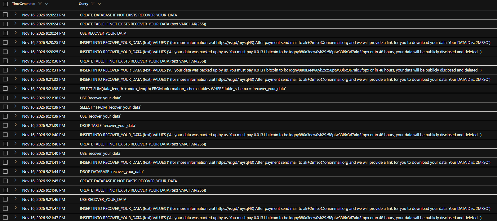
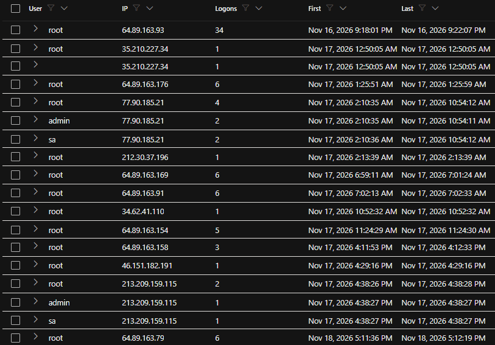

# Incident Report: corp-aafbc-6962 MySQL Ransom

Nov 19, 2026 · Eliezer Fuentes

**Classification:** Data Destruction / Ransom (automated) — **Severity:
High.** An internet-exposed MySQL root account on the VM corp-aafbc-6962
was used to read, then destroy, the mcgraw_hill_holdings_corp database
and leave a Bitcoin ransom note. The Windows host was not compromised.

## 1. 📌 Executive Summary

On Nov 16, 2026, roughly 1.5 hours after the lab VM corp-aafbc-6962 was
deliberately exposed to the internet, an automated attacker logged in to
its MySQL service as root over the internet and, within about two
minutes, read every table in the mcgraw_hill_holdings_corp database,
dropped the database, and wrote a Bitcoin ransom note demanding 0.0131
BTC. The attacker then attempted anti-forensics (purged MySQL binary
logs) and stopped the database service. The same box was re-hit by
multiple automated actors over the following ~14 hours, and the Windows
administrator account was separately brute-forced but never cracked —
the OS itself was not compromised. All affected data was synthetic lab
data; the incident is contained.

## 2. 🧾 Incident Details

| Field                 | Value                                                                            |
|-----------------------|----------------------------------------------------------------------------------|
| Detection date/time   | Nov 16, 2026, 9:18 PM EST (first malicious connection); confirmed via log review |
| Reporter              | Eliezer Fuentes (SOC analyst)                                                    |
| Classification        | Impact: Data Destruction (T1485) + Financial Theft / ransom (T1657), automated   |
| Severity              | High (full database destroyed; attempted anti-forensics)                         |
| Affected asset        | corp-aafbc-6962 — Windows 11 Azure VM, MySQL 8.0, workspace LAW-Cyber-Range      |
| Affected data         | mcgraw_hill_holdings_corp database (synthetic PII/financial lab data)            |
| Exposure window start | 2026-11-17 00:42:36 UTC (Nov 16, 7:42 PM EST), per Phase 5 exposure timestamp    |
| Host OS compromise    | None — Windows logon/process/file/registry telemetry shows no attacker foothold  |

Times below are Eastern (EST) as the Defender portal displays them; raw
log timestamps are UTC.

## 3. 💥 Impact Assessment

- **Confidentiality — possible breach.** The attacker ran SELECT *
  against all seven tables (customers, credentials, orders, payments,
  refunds, devices, activity_logs) before deletion, so the data was read
  in-session. Whether it left the environment was **not determined from
  available logs** — no exfil destination was confirmed, and tenant
  egress is centrally restricted. Data at risk is synthetic (names,
  SSNs, card last-4, password hashes).

- **Integrity — destroyed.** The mcgraw_hill_holdings_corp database and
  all tables were dropped. The database no longer exists on the host.

- **Availability — lost.** Database destroyed; MySQL SHUTDOWN issued;
  binary logs purged (RESET MASTER / PURGE BINARY LOGS), removing
  point-in-time recovery. A separate VM connectivity issue (Bastion
  “unstable / closed connection”) was observed on Nov 19; **whether it
  is related to this incident was not determined** and is being raised
  with the lab team.

- **Scope.** One VM, one database. Windows OS not compromised. No
  lateral movement observed.

- **Business impact (lab context).** None to real data; recovery is a
  database restore from backup. In a production analogue, this would be
  a full customer-database loss with potential PII/PCI exposure.

## 4. 🧬 Indicators of Compromise

All IOCs below are taken from this incident's logs (the example IOCs in
the task prompt did not match this environment and are not used).

| Type        | Value                                                       | Role                                                                     |
|-------------|-------------------------------------------------------------|--------------------------------------------------------------------------|
| BTC wallet  | bc1qgny880a3eew0yk29z58ptw33l6x367alq3fppx                  | Ransom demand (0.0131 BTC)                                               |
| Email       | ak+2mfso@onionmail.org                                      | Attacker contact                                                         |
| URL         | hxxps://is[.]gd/mysql43                                   | Ransom note link                                                         |
| DATAID      | 2MFSO                                                       | Victim identifier in note                                                |
| IP          | 64.89.163.93                                                | Primary actor — data read + destruction + ransom (AS401626 / 10gig.host) |
| IP          | 64.89.163.176, .169, .91, .154, .158                        | Same block — re-ransom / note re-plants                                  |
| IP          | 77.90.185.21, 35.210.227.34, 212.30.37.196, 213.209.159.115 | Additional successful root logins (spray / revisit)                      |
| IP          | 34.62.41.110, 46.151.182.191                                | Failed root/admin/sa MySQL spray                                         |
| IP          | 194.180.49.140                                              | Windows administrator RDP/SMB brute force — **all failed**               |
| DB artifact | Database RECOVER_YOUR_DATA, table RECOVER_YOUR_DATA         | Ransom note container                                                    |

## 5. ⏱️ Timeline

Times in EST. Source table cited per row.

| Time (EST)                 | Event                                                                            | Source                       |
|----------------------------|----------------------------------------------------------------------------------|------------------------------|
| Nov 16, 7:42 PM            | VM exposed to internet (firewall off, NSG allow-all, MySQL root@% reachable)     | Phase 5 exposure timestamp   |
| Nov 16, 9:18 PM            | First root login from 64.89.163.93 (TCP/IP) after one failed attempt             | MySQLAudit_CL (Auth)         |
| Nov 16, 9:20:28 PM         | GRANT CREATE, DROP ON *.* TO root@% — self-escalation                          | MySQLAudit_CL (Query)        |
| Nov 16, 9:20:31–9:21:15 PM | USE mcgraw_hill_holdings_corp; SELECT * on all 7 tables (data read)             | MySQLAudit_CL (Query)        |
| Nov 16, 9:20:23 PM         | First CREATE DATABASE RECOVER_YOUR_DATA + ransom note inserted                   | MySQLAudit_CL (Query)        |
| Nov 16, 9:21:17–9:21:23 PM | ALTER TABLE … DROP FOREIGN KEY ×7, then DROP TABLE ×7                            | MySQLAudit_CL (Query)        |
| Nov 16, 9:21:42 PM         | DROP DATABASE mcgraw_hill_holdings_corp                                          | MySQLAudit_CL (Query)        |
| Nov 16, 9:22:03–9:22:05 PM | RESET MASTER, PURGE BINARY LOGS, REVOKE … root@%, SHUTDOWN                       | MySQLAudit_CL (Query)        |
| Nov 17, 1:25–11:24 AM      | Re-ransom note re-plants from 64.89.163.176/.169/.91/.154                        | MySQLAudit_CL (Auth + Query) |
| Nov 17, 6:20–6:31 AM       | Windows administrator brute force from 194.180.49.140 — ~32 attempts, all failed | DeviceLogonEvents            |
| Nov 18, 6:24 PM            | VM isolated in Microsoft Defender                                                | Phase 8 isolation timestamp  |

*Figure 1 — MySQLAudit_CL destruction sequence (DROP / CREATE / note), ~9:20–9:22 PM EST.*

Hunt used to build the destruction timeline: see the hunt queries in [`queries/`](../queries) (02–destruction / 03–ransom notes).

## 6. ⛓️ Root Cause / Attack Vector

**Root cause:** the MySQL service was reachable from the public internet
(port 3306) with a weak, network-enabled root@'%' account — the
vulnerable state deliberately created in Phase 5. Internet scanners
found the open port within ~1.5 hours and an automated ransom bot
authenticated as root and executed its routine (read → drop → ransom
note → anti-forensics). No exploit or privilege-escalation flaw was
required; valid credentials over an exposed service were sufficient
(T1110 → T1078).

**Windows vector (failed):** administrator was brute-forced over the
network from 194.180.49.140; all attempts failed and no OS-level access
was gained. Host process, file, and registry telemetry show only normal
Windows/Defender/Azure activity and the analyst's own pfisher session —
no attacker binaries, persistence, or encryption.

**Explicitly not determined from available logs:** whether database
contents were exfiltrated off-host (no confirmed outbound destination);
whether the Nov 19 Bastion connectivity failure is related to this
incident.

## 7. ♻️ Response Actions

**Containment (taken):**

- VM isolated in Microsoft Defender on Nov 18, 6:24 PM EST.

- Pre-breach and post-breach Defender investigation packages captured
  for comparison.

**Eradication & recovery (recommended — lab calls for rebuild):**

1.  Destroy the VM (both the DB and the exposed service were
    compromised) and redeploy clean, **or** harden in place.

2.  Harden MySQL: set bind-address = 127.0.0.1; remove the network
    root@'%' account (or set a strong password and restrict host); never
    expose 3306 to the internet.

3.  Harden Windows/network: re-enable Windows Firewall; tighten the NSG
    to deny inbound 3306/3389 from the internet; remove the weak
    administrator account and keep guest disabled; strong local
    credentials.

4.  Restore mcgraw_hill_holdings_corp from backup (backup set available
    in the connected DB backup folder) — do **not** restore from binary
    logs, which the attacker purged.

5.  Run a full Microsoft Defender antivirus scan before removing
    isolation.

**Note:** the attacker-created network root@'%' grant was later REVOKEd
by the attacker itself during anti-forensics; still verify no residual
root@'%' account or RECOVER_YOUR_DATA database remains after recovery.

## 8. 📂 Evidence

**Artifacts referenced:**

- MySQLAudit_CL exports: Auth logs and Query logs for corp-aafbc-6962.

- DeviceLogonEvents, DeviceProcessEvents, DeviceFileEvents,
  DeviceRegistryEvents exports (exposure → isolation window).

- Defender investigation packages: pre-breach and post-breach (for
  host-change comparison).

- Ransom note text (recovered from RECOVER_YOUR_DATA.RECOVER_YOUR_DATA).

**Key hunts.** The queries referenced here are in [`queries/`](../queries); the figure below shows the successful-login summary output.

*IOC login summary output*

## 9. 🗺️ Lessons Learned & Recommendations

Prioritized, highest-impact first:

1.  **Never expose database services to the internet.** Bind MySQL to
    127.0.0.1 and keep 3306 off any public NSG rule. This single control
    would have prevented the entire incident.

2.  **Eliminate weak/network-wide DB accounts.** No root@'%'; use
    least-privilege accounts, strong passwords, and host restrictions.
    Weak valid credentials — not an exploit — were the whole attack.

3.  **Protect and centralize logs for recovery and forensics.** The
    attacker purged MySQL binary logs, but the audit stream was already
    shipped to Sentinel — centralized logging preserved the full
    timeline. Keep off-host, immutable backups so PURGE BINARY LOGS
    cannot destroy recovery.

4.  **Alert on destructive DB statements in near-real-time.** The
    scheduled analytics rules detected the logins; add a rule for DROP
    DATABASE / DROP TABLE / RECOVER_YOUR_DATA so destruction pages
    immediately rather than being found in review.

5.  **Validate detections actually fire.** Confirm the Sentinel rules
    (aafbc6962-Cyber-Defence-Final-*) generated incidents from this
    activity; a rule that is enabled but never triggers is not a
    detection.

6.  **Confirm exfiltration scope.** Query NTANetAnalytics for outbound
    flows from the VM during the breach window to determine whether data
    left the host before closing the case.
